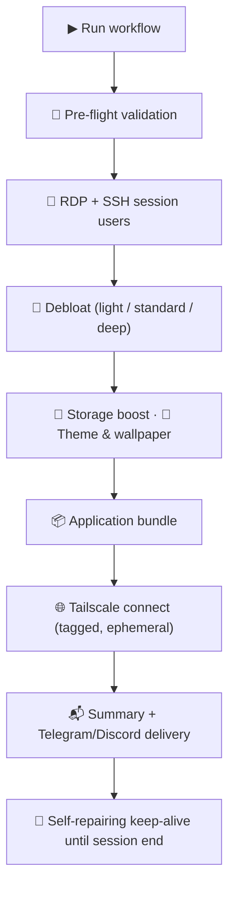

<div align="center">
  
</div>

<div align="center">


**A fully automated, customizable remote desktop session** deployed from GitHub Actions and reachable only through your own private Tailscale network. Credentials are delivered **privately** to your Telegram or Discord (when configured) the moment the session is ready. Sessions are ephemeral: the machine exists for the lifetime of the workflow run and is destroyed afterwards.

</div>

---

## ⚠️ Read before running

> [!WARNING]
> **This is not CI/CD.** Running an interactive desktop on GitHub-hosted runners falls outside GitHub's intended use for Actions ("any other activity unrelated to the production, testing, deployment, or publication of the software project associated with the repository"). GitHub actively monitors for this pattern and may suspend accounts that abuse Actions resources. Run sparingly, and understand that you accept this risk yourself.

> [!IMPORTANT]
> - **The environment is ephemeral.** Everything on the machine is destroyed when the session ends or the run is cancelled. Never store personal or sensitive data inside it.
> - **No gaming.** The runner has no GPU, and running games or anti-cheat-protected software on it violates those products' terms on top of the risks above.
> - **Concurrency.** Starting a NEW run cancels the live session immediately (see the warning in every run Summary).

### What you actually get

| Property | Value |
|----------|-------|
| Operating system | Windows Server 2025 (GitHub's `windows-latest` image — a server edition, not a Windows 11 desktop) |
| Hardware | 4 vCPUs, 16 GB RAM, ~14 GB free disk (more with `storage_boost`) |
| Session lifetime | 1–6 hours, your choice (default 6) |
| Access | RDP + SSH terminal over Tailscale only — no public IPs, no open ports |
| Accounts | `runneradmin` (main, personalized) and `lazyuser` (clean spare), **random passwords per run** (or your own `RDP_PASSWORD`) |
| Credentials | **Never displayed in the Summary** — sent to your Telegram and/or Discord when configured. Set `RDP_PASSWORD` to own the password yourself. |

---

## 🚀 Quick start

### 1. Fork this repository

Click **Fork**, then work from your fork — not from this upstream copy.

### 2. Connect your Tailscale tailnet (required)

The session joins your tailnet as a **tagged, ephemeral device** through a Tailscale **OAuth client** — OAuth clients never expire, so this is a one-time setup.

1. **Define the node tag** — an OAuth client owns no user, so its devices must carry a tag. Open [Access Controls](https://login.tailscale.com/admin/acls) and merge this into the top-level JSON object:
   ```json
   "tagOwners": {
     "tag:lazyrdp": ["autogroup:admin"]
   }
   ```
2. **Create the OAuth client** — open [Settings > OAuth clients](https://login.tailscale.com/admin/settings/oauth) → **Generate OAuth client** → grant the writable **Auth Keys** scope, select the **`tag:lazyrdp`** tag, then copy the **Client ID** and **Client Secret** (the secret is shown only once).
3. Ephemeral nodes are removed from your tailnet automatically when the session ends.

### 3. Set up credential delivery (optional but recommended)

Without these secrets the workflow still works, but **generated passwords are unreachable** — the Summary and the logs always mask them (pre-flight warns before any setup time is spent). For a password you already know, set `RDP_PASSWORD` instead.

**Telegram:**

1. Message [@BotFather](https://t.me/BotFather) → `/newbot` → follow the prompts → copy the **bot token** (`123456:ABC-...`).
2. Send any message to your new bot, then open `https://api.telegram.org/bot<TOKEN>/getUpdates` in a browser and find `"chat":{"id":<NUMBER>}` — that number is your **chat ID**. (Or message [@userinfobot](https://t.me/userinfobot).)

**Discord:**

1. Server Settings → **Integrations** → **Webhooks** → **New Webhook** → pick a channel → **Copy Webhook URL**.

### 4. Store the secrets

In your fork: **Settings > Secrets and variables > Actions > New repository secret**

| Secret | Required | Purpose |
|--------|----------|---------|
| `TAILSCALE_OAUTH_CLIENT_ID` | ✅ | Tailscale OAuth client for network access (never expires) |
| `TAILSCALE_OAUTH_CLIENT_SECRET` | ✅ | The client's secret (`tskey-client-...`, shown once at creation) |
| `RDP_PASSWORD` | recommended | **Own your session password.** The Summary never displays passwords; without notification secrets AND without `RDP_PASSWORD`, generated passwords are unreachable (pre-flight warns). Applies to both accounts; 8+ characters recommended. |
| `TELEGRAM_BOT_TOKEN` | optional | Telegram credential delivery |
| `TELEGRAM_CHAT_ID` | optional | Telegram credential delivery |
| `DISCORD_WEBHOOK_URL` | optional | Discord credential delivery |

### 5. Run the workflow

Go to **Actions > LazyRDP > Run workflow** and pick your options:

| Input | Choices | Meaning |
|-------|---------|---------|
| Theme | `dark` / `light` | Desktop color mode |
| Application bundle | `all` / `streaming` / `minimal` / `clean` | `all`: Chrome, Steam, OBS, Google Drive, Rainmeter + Mond · `streaming`: Chrome, OBS, Rainmeter + Mond · `minimal`: Chrome · `clean`: nothing |
| Wallpaper URL | any direct image URL | Optional; validated before setup starts — if it is not a reachable image, the bundled default wallpaper is applied instead |
| Session hours | `1` – `6` | How long the session stays up (shuts down gracefully before the platform cap) |
| Storage boost | `no` / `yes` | Removes unused preinstalled toolchains (Android SDK, Docker images, Go, Haskell, CodeQL, caches) and frees tens of GB |
| Debloat level | `light` / `standard` / `deep` | `light`: performance tuning only · `standard` (default): consumer bloatware + telemetry off · `deep`: adds aggressive removals vetted for short sessions (more packages and services, Windows Update held for the session) |

### 6. Connect

1. Wait for the run — when the session is ready, **your Telegram/Discord receives the IP, both accounts, and passwords**. (If you skipped steps 3–4 entirely, no message is sent and the generated passwords are **not recoverable from the run at all** — the Summary and the logs mask them alike; pre-flight warns about this before setup starts.)
2. The run **Summary** always shows the address, the end time, and step-by-step connection instructions — passwords are never displayed there; they reach you through your channels (or are the `RDP_PASSWORD` you chose).
3. Install the Tailscale client on your device, sign in to the same tailnet, then connect with any RDP client to the `100.x.x.x` address.
4. **Sign in as `runneradmin`** — that account carries all personalization (theme, wallpaper, mouse tuning, OBS profile).
5. *(Optional)* Terminal access without a desktop: `ssh runneradmin@<ip>` — port 22, same credentials, PowerShell 7 shell.

---

## ⚙️ How it works



- **Pre-flight validation** — fails in seconds with a clear message if the Tailscale OAuth secrets are missing or the theme is invalid, verifies the wallpaper URL (falling back to the bundled default when it is not an image), and warns up-front when no credential delivery path (notification channels or `RDP_PASSWORD`) exists, instead of wasting minutes of setup first.
- **Secure provisioning** — enables RDP with Network Level Authentication and creates two accounts secured by per-run random passwords (or your own `RDP_PASSWORD`). Enables the OpenSSH Server on port 22 (same accounts, PowerShell 7 default shell) for terminal-only access. SSH and RDP firewall rules are restricted to the Tailscale subnet (`100.64.0.0/10`) — defense in depth on top of the hosting network's own inbound filtering. Registry writes go through a hardened ladder (existing-value write → create → `reg.exe` → take key ownership) borrowed from XyRDP's documented findings about TrustedInstaller-owned keys.
- **Debloat in three levels** — `light` applies only the Ultimate Performance power plan and disables mouse acceleration; `standard` (the default, the historical behavior) also removes consumer bloatware and disables telemetry services; `deep` goes further with what a short-lived session safely tolerates: more AppX packages (Copilot, Teams, GameBar, Clipchamp, new Outlook, PowerAutomate, Cortana, Mail/Calendar), more services (Search indexing, Print Spooler, SysMain, the Xbox stack, error reporting), Windows Update held for the session so nothing reboots mid-use, and the Compatibility Appraiser task disabled. Session-critical components (Tailscale, the RDP listener, SSH) are never touched at any level. Server Manager (and the legacy initial-configuration window) never auto-open at logon.
- **Storage boost (optional)** — frees tens of gigabytes by removing SDKs and toolchains a desktop session never uses, reporting the real freed number.
- **Personalization** — applies the chosen theme and validated wallpaper. Timezone redirection is enabled, so the session clock automatically adopts the **connecting device's** time zone at RDP connect time (no manual configuration, any country). The wallpaper is verified twice (response headers **and** file signature), and a branded default bundled in the repo is applied whenever a custom URL fails (hotlink protection, bot checks, wrong content-type) — with the exact failure reason logged and shown in the Summary.
- **Application bundles** — installs Chrome directly from Google's signed enterprise MSI (winget's community manifest repeatedly trailed Google's rolling installer), and the remaining packages in parallel via winget with a source-refresh retry; a failed package never blocks the session, and its winget log is printed into the run log.
- **Private credential delivery** — the moment the session is ready, Telegram and/or Discord receive the full connection details **including passwords**. The Summary **never** displays passwords in any mode — they live in your private channels (or in your `RDP_PASSWORD` secret); pre-flight warns when no delivery path exists.
- **Self-repairing keep-alive** — every 5 minutes the session verifies the Tailscale service, the actual tailnet connection, and the RDP listener. If the node drops off the tailnet it re-joins automatically, if the service itself stopped it is started first (up to 3 attempts), and if the IP changes the Summary gains an "IP UPDATED" section and your channels receive the new address.
- **Quality gate** — pull requests and direct pushes to `main` are linted with actionlint (workflow files) and PSScriptAnalyzer (PowerShell scripts) so a broken change never reaches a run.

All provisioning logic lives in `scripts/*.ps1`; the workflow file is a thin orchestrator that passes user inputs through environment variables (never text interpolation), which closes the script-injection vector that earlier versions had.

---

## 🩺 Troubleshooting

<details>
<summary><strong>Open the troubleshooting table</strong></summary>

| Symptom | Likely cause and fix |
|---------|----------------------|
| Run fails at pre-flight: `TAILSCALE_OAUTH_CLIENT_ID / TAILSCALE_OAUTH_CLIENT_SECRET secrets are not set` | Create the OAuth client as described in step 2 and add both secrets (step 4) |
| Run fails at the Tailscale step | The OAuth client lacks the writable **Auth Keys** scope, `tag:lazyrdp` is not defined in your tailnet's Access Controls, or the client was revoked — recreate the client as described in step 2 (OAuth clients never expire) |
| Wrong credentials | Credentials differ per run and are always masked in the Summary **and the logs** — read them from the notification message of **that specific run**, or use your `RDP_PASSWORD` if you set one. If no channel delivered, the generated passwords are unrecoverable: start a new run with delivery configured (pre-flight warns when it is missing) |
| No Telegram/Discord message | Check the `NOTIFY: Telegram=... \| Discord=...` verdict line in the **Publish summary and keep the session alive** step log. Secrets are snapshotted at run start — if you added them after starting, start a NEW run |
| Cannot connect from your device | Your device must be signed in to the **same tailnet**; check the Tailscale client status before blaming the session |
| IP stopped working mid-session | The watchdog repaired a drop and the IP changed — the Summary has an "IP UPDATED" section and your channels got the new address |
| An application failed to install | The session still comes up; the last lines of the winget log are printed in the install step log — review them there, then rerun |
| Session ended earlier than expected | The `session_hours` input elapsed, or a newer run replaced this one; the Summary shows the planned end time |
| Job killed at exactly 6 hours | The platform cap — choose a lower `session_hours` value for graceful shutdown |
| Display feels laggy | This runner encodes video on the CPU (no GPU). In mstsc: **Experience** tab → pick **LAN (10 Mbps or higher)**, keep **Persistent bitmap caching** enabled, and reconnect. Heavier graphics modes (e.g. AVC 444) make it worse, not better |
| Desktop black but pointer visible | Press Ctrl+Alt+End > Task Manager > Run new task > `explorer.exe` |

</details>

---

## 📜 Changelog

### v8.3
- **Tailscale OAuth instead of auth keys:** the session now joins your tailnet as a tagged ephemeral node through a Tailscale OAuth client (`TAILSCALE_OAUTH_CLIENT_ID` + `TAILSCALE_OAUTH_CLIENT_SECRET`) — OAuth clients never expire, which permanently removes the "auth key expired" failure mode. The node tag (`tag:lazyrdp`) must exist in the tailnet's Access Controls, and the self-repairing watchdog re-joins with the same OAuth mechanism.
- **Cleaner logon:** Server Manager (and the legacy initial-configuration window) no longer auto-open at logon, at every debloat level.

<details>
<summary><strong>Older versions</strong></summary>

### v8.2
- **Debloat levels:** new `debloat_level` input — `light` (performance tuning only), `standard` (the previous fixed behavior, still the default) and `deep` (aggressive removals vetted for a short-lived RDP session: extra AppX packages, extra services, Windows Update held for the session, Compatibility Appraiser disabled). The Summary reports the applied level with package/service counts, and session-critical components are never touched at any level.

### v8.1
- **SSH terminal access:** OpenSSH Server runs on port 22 over Tailscale (same accounts and password, PowerShell 7 default shell) for desktop-free terminal access. An H.264/AVC 444 graphics preference was also tried and **reverted**: with no GPU, 444 encoding runs on the CPU and visibly lagged the display. A Windows audio stack feature was removed the same day after real-world testing: GitHub Actions VMs ship **no audio hardware**, so the audio services have no endpoints to redirect and Remote Audio can never produce sound.
- **Automatic timezone:** the manual `timezone` input was removed — RDP timezone redirection (`fEnableTimeZoneRedirection`) is enabled instead, so the session clock automatically adopts the **connecting device's** time zone when you connect via mstsc. The Summary shows UTC only.
- **Passwords are ALWAYS masked in the Summary** — in every mode, regardless of delivery outcome (owner directive). Passwords travel exclusively to the configured Telegram/Discord channels; with `RDP_PASSWORD` set you own the password yourself, and pre-flight warns up-front when no delivery path exists for generated passwords.
- **Wallpaper robustness:** images are now verified by file signature (magic bytes) when headers lie; a branded default wallpaper bundled in the repo (`assets/wallpaper.jpg`) is applied whenever the custom URL fails, and the exact failure reason (status/content-type) is logged and shown in the Summary.
- **Unambiguous delivery verdicts:** every channel prints a `NOTIFY: Telegram=DELIVERED|FAILED|NOT_CONFIGURED` line, the delivery state is published to a temp file the Summary step re-reads (no reliance on output capture), and the Summary clarifies that secrets are snapshotted at run start — adding secrets after starting a run requires a new run.

### v8.0
- **Private credential delivery:** Telegram and/or Discord receive the full connection details when the session is ready; the Summary hid passwords unless no channel delivered (a fallback behavior that v8.1 removed — the Summary now always masks). New optional secrets: `TELEGRAM_BOT_TOKEN`, `TELEGRAM_CHAT_ID`, `DISCORD_WEBHOOK_URL`.
- **Self-repairing sessions:** the keep-alive watchdog now verifies the actual Tailscale tailnet connection (not just the service), re-joins automatically after a drop (max 3 attempts), and if the IP changes it updates the Summary with an "IP UPDATED" section and re-notifies your channels.
- **XyRDP-inspired hardening:** a registry-write ladder (existing-value write → create → `reg.exe` → take key ownership) protects every registry write against TrustedInstaller-owned key denials documented on the 2025 runner images.
- **New inputs:** `storage_boost` (frees tens of GB by removing Android SDK, Docker images, Go, Haskell, CodeQL and caches, reporting the real freed number) and `timezone` (validated Windows time zone Id applied to the session).
- **Summary improvements:** explicit concurrency warning (a new run cancels the live session), timezone and storage notes, and the `explorer.exe` recovery tip.
- **Lineage:** starts from `Windows-11-Ultimate-RDP` v7.5 — which itself carried the v7.4 overhaul (random masked-then-unmasked credentials, env-based input passing, official pinned Tailscale action, Chrome direct signed-MSI install, explicit `exit 0` for pwsh runner semantics, per-step timeouts, pre-flight validation, Quality Gate CI).

### v7.5 and earlier
See the `Windows-11-Ultimate-RDP` repository history.

</details>

---

> [!CAUTION]
> This project is for educational and experimental purposes. It is an **ephemeral environment** — the machine and all its data are permanently destroyed when the workflow is cancelled or completes. Do not store critical or sensitive data in a session, and use GitHub's resources responsibly and in accordance with their terms of service.

<div align="center">

## 📄 License

[MIT](LICENSE)

Maintained by **[LazyByte0x](https://github.com/LazyByte0x)** — registry hardening, storage-boost and session-resilience patterns inspired by [XyRDP](https://github.com/xykal/XyRDP).

</div>
